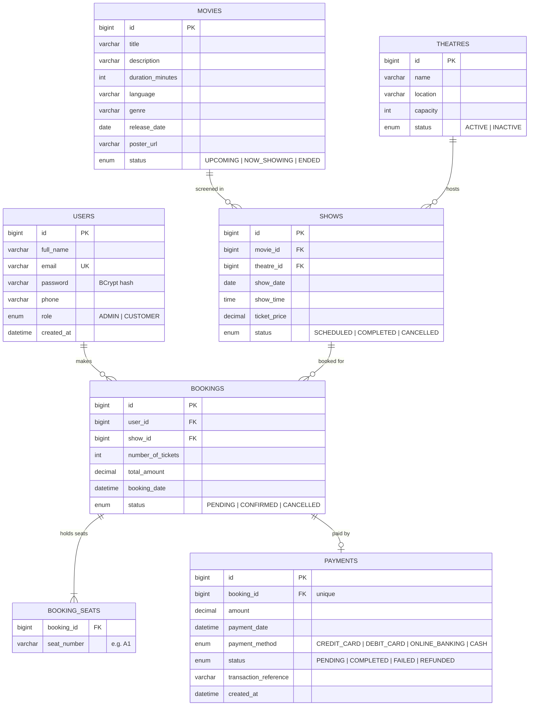

# 🎬 CineBook — Movie Ticket Booking System

**CMJD 114/115 · IJSE** — Assignment 1 (Spring Boot + MySQL backend) and Assignment 2 (React + TypeScript frontend).

Customers browse movies and showtimes, pick exact seats on a seat map, book tickets and pay.
Administrators manage users, movies, theatres, shows, bookings and payments.
Security uses **Spring Security + JWT**.

```
movie-ticket-booking-system/
├── backend/            Spring Boot REST API (Java 17+, Maven)
├── frontend/           React + TypeScript (Vite, React Router, Axios, Tailwind CSS)
├── database/
│   └── schema.sql      MySQL script: database, tables, constraints, sample data
├── docs/
│   └── FUTURE_EXPANSION.md
└── README.md
```

---

## 1. Technologies used

| Layer | Technology |
|---|---|
| Backend | Spring Boot 3.3, Spring Web, Spring Data JPA (Hibernate 6), Spring Security, JWT (jjwt 0.12), Bean Validation, Lombok, SLF4J/Logback |
| Database | MySQL 8 |
| Build | Maven |
| Frontend | React 18 + TypeScript, Vite, React Router 6, Axios, Tailwind CSS 4, Context API |
| VCS | Git + GitHub |

**Architecture:** `Controller → Service (interface + impl) → Repository → Database`, with DTOs for every request/response, a `GlobalExceptionHandler`, enums for all roles/statuses, and logging of important activities (sign-ups, bookings, payments, cancellations…) to the console and `backend/logs/movie-ticket-booking.log`.

---

## 2. Entity Relationship Diagram



| Relationship | JPA mapping |
|---|---|
| User 1:M Booking | `@OneToMany(mappedBy="user")` / `@ManyToOne` |
| Movie 1:M Show | `@OneToMany(mappedBy="movie")` / `@ManyToOne` |
| Theatre 1:M Show | `@OneToMany(mappedBy="theatre")` / `@ManyToOne` |
| Show 1:M Booking | `@OneToMany(mappedBy="show")` / `@ManyToOne` |
| Booking 1:1 Payment | `@OneToOne` (FK + unique key on `payments.booking_id`) |
| Booking seat numbers | `@ElementCollection` → `booking_seats` table (part of the Booking entity, as the brief allows) |

**Seat numbering:** a theatre with capacity *N* has seats in rows of 10 — `A1…A10`, `B1…B10`, … — so a 100-seat theatre has rows A–J.

---

## 3. Database configuration

1. Open **MySQL Workbench**, connect to your local server, open `database/schema.sql` and run it (⚡ *Execute All*). It creates `movie_ticket_booking_db`, all tables and sample movies/theatres/shows.
2. Set your MySQL username/password in `backend/src/main/resources/application.properties`:

```properties
spring.datasource.url=jdbc:mysql://localhost:3306/movie_ticket_booking_db?createDatabaseIfNotExist=true&useSSL=false&allowPublicKeyRetrieval=true&serverTimezone=Asia/Colombo
spring.datasource.username=${DB_USERNAME:root}
spring.datasource.password=${DB_PASSWORD:1234}
spring.jpa.hibernate.ddl-auto=update
```

Either edit the defaults (`root` / `1234`) or set environment variables `DB_USERNAME` and `DB_PASSWORD`.
`ddl-auto=update` keeps the tables made by the script (and would create them if you skipped it).

---

## 4. How to run the project

### Prerequisites
- JDK 17 or newer, Maven 3.9+ (or IntelliJ IDEA's bundled Maven)
- MySQL 8 + MySQL Workbench
- Node.js 20+ and npm

### Backend (port 8080)
```bash
cd backend
mvn clean install -DskipTests
mvn spring-boot:run
```
Or open `backend/` in IntelliJ IDEA and run `MovieTicketBookingApplication`.

On first start the app creates the default admin:

| Email | Password |
|---|---|
| `admin@movieticket.lk` | `Admin@123` |

### Frontend (port 5173)
```bash
cd frontend
npm install
npm run dev
```
Open http://localhost:5173. The Vite dev server forwards `/api/*` to `http://localhost:8080`, so no extra configuration is needed.
Production build: `npm run build` (output in `frontend/dist`).

---

## 5. Authentication instructions

1. **Sign up** (customers) — `POST /api/auth/signup` → returns a JWT.
2. **Sign in** — `POST /api/auth/signin` → returns a JWT.
3. Send the token on every protected request:
   ```
   Authorization: Bearer <token>
   ```
4. Tokens expire after 24 h (`app.jwt.expiration-ms`). Public sign-up always creates `CUSTOMER` accounts; an admin can promote a user to `ADMIN` with `PUT /api/users/{id}`.

| Who | Can access |
|---|---|
| Anyone | `GET` movies, theatres, shows, seat availability; sign up / sign in |
| CUSTOMER | create bookings, view/cancel own bookings, make payments, view own payments, own profile |
| ADMIN | everything above (except creating bookings) + manage users, movies, theatres, shows, view all bookings, update booking status, view all payments, dashboard stats |

Errors use one JSON shape, e.g. `401 Unauthorized`, `403 Forbidden`, `404 Not Found`, `409 Conflict`:
```json
{ "timestamp": "2026-10-12T18:40:11", "status": 409, "error": "Conflict",
  "message": "Seat(s) already booked for this show: A1", "path": "/api/bookings" }
```
Validation failures (`400`) also include `"validationErrors": { "field": "message" }`.

---

## 6. API endpoints

### Authentication
| Method | Endpoint | Access | Description |
|---|---|---|---|
| POST | `/api/auth/signup` | Public | Register a customer |
| POST | `/api/auth/signin` | Public | Sign in, receive JWT |

### Users
| Method | Endpoint | Access | Description |
|---|---|---|---|
| GET | `/api/users` | ADMIN | All users |
| GET | `/api/users/me` | Authenticated | Own profile |
| GET | `/api/users/{id}` | ADMIN / self | User by ID |
| PUT | `/api/users/{id}` | ADMIN / self | Update user (role: ADMIN only) |
| DELETE | `/api/users/{id}` | ADMIN | Delete user |

### Movies
| Method | Endpoint | Access | Description |
|---|---|---|---|
| POST | `/api/movies` | ADMIN | Create movie |
| GET | `/api/movies?title=&language=&genre=&status=&page=0&size=10&sort=title,asc` | Public | Search + paginate |
| GET | `/api/movies/{id}` | Public | Movie by ID |
| GET | `/api/movies/{id}/shows?upcomingOnly=true` | Public | Shows for a movie |
| PUT | `/api/movies/{id}` | ADMIN | Update movie |
| DELETE | `/api/movies/{id}` | ADMIN | Delete movie |

### Theatres
| Method | Endpoint | Access | Description |
|---|---|---|---|
| POST | `/api/theatres` | ADMIN | Create theatre |
| GET | `/api/theatres?status=ACTIVE` | Public | All theatres |
| GET | `/api/theatres/{id}` | Public | Theatre by ID |
| PUT | `/api/theatres/{id}` | ADMIN | Update theatre |
| DELETE | `/api/theatres/{id}` | ADMIN | Delete theatre |

### Shows
| Method | Endpoint | Access | Description |
|---|---|---|---|
| POST | `/api/shows` | ADMIN | Create show |
| GET | `/api/shows?movieId=&theatreId=&date=&status=&upcomingOnly=&page=0&size=10` | Public | Filter + paginate |
| GET | `/api/shows/{id}` | Public | Show by ID |
| GET | `/api/shows/{id}/seats` | Public | Seat map + booked seats |
| PUT | `/api/shows/{id}` | ADMIN | Update show (setting `CANCELLED` cancels its bookings) |
| DELETE | `/api/shows/{id}` | ADMIN | Delete show |

### Bookings
| Method | Endpoint | Access | Description |
|---|---|---|---|
| POST | `/api/bookings` | CUSTOMER | Create booking |
| GET | `/api/bookings?status=&page=0&size=10` | ADMIN | All bookings |
| GET | `/api/bookings/my-bookings?page=0&size=10` | Authenticated | Own bookings |
| GET | `/api/bookings/{id}` | Owner / ADMIN | Booking by ID |
| PUT | `/api/bookings/{id}/cancel` | Owner / ADMIN | Cancel booking |
| PUT | `/api/bookings/{id}/status` | ADMIN | Update booking status |

### Payments
| Method | Endpoint | Access | Description |
|---|---|---|---|
| POST | `/api/payments` | Owner / ADMIN | Create payment for a booking |
| PUT | `/api/payments/{id}/process` | Owner / ADMIN | Process payment (simulated gateway) |
| GET | `/api/payments/{id}` | Owner / ADMIN | Payment details |
| GET | `/api/payments/{id}/status` | Owner / ADMIN | Check payment status |
| GET | `/api/payments/booking/{bookingId}` | Owner / ADMIN | Payment of a booking |
| GET | `/api/payments/my-payments` | Authenticated | Own payments |
| GET | `/api/payments?status=&page=0&size=10` | ADMIN | All payments |

### Admin
| Method | Endpoint | Access | Description |
|---|---|---|---|
| GET | `/api/admin/stats` | ADMIN | Dashboard counts and revenue |

---

## 7. Business rules implemented

**Movies** — only ADMIN creates/updates/deletes; `ENDED` movies can't get new shows; a movie with shows can't be deleted (set it to `ENDED`).
**Theatres** — only ADMIN manages them; shows only in `ACTIVE` theatres; capacity can't shrink below already-booked seats.
**Shows** — must reference an existing movie and theatre; must be in the future; the same theatre can't have overlapping shows (running time + 15-min buffer, so the "same date and time" case is covered too); `CANCELLED`/`COMPLETED` shows don't accept bookings; once a show has bookings its movie/theatre/date/time are locked.
**Bookings** — only authenticated CUSTOMERs book; ≥ 1 seat (max 10); `numberOfTickets` must equal the number of seats; seats must exist in the theatre; already-booked seats are rejected (`409`) — the show row is locked during booking so two people can't grab the same seat at once; `totalAmount = ticketPrice × numberOfTickets`; new bookings are `PENDING`; cancelling releases the seats.
**Payments** — always tied to a booking (1:1); cancelled bookings can't be paid for; `COMPLETED` → booking `CONFIRMED`; `FAILED` → booking stays `PENDING` (retry allowed); a completed payment can't be processed again (`409`); cancelling a paid booking marks its payment `REFUNDED`.

---

## 8. Sample API requests

```bash
# Sign up
curl -X POST http://localhost:8080/api/auth/signup -H "Content-Type: application/json" \
  -d '{"fullName":"Nimal Perera","email":"nimal@example.com","password":"secret123","phone":"0771234567"}'

# Sign in (copy "token" from the response)
curl -X POST http://localhost:8080/api/auth/signin -H "Content-Type: application/json" \
  -d '{"email":"nimal@example.com","password":"secret123"}'

# Browse
curl "http://localhost:8080/api/movies?status=NOW_SHOWING&page=0&size=10"
curl "http://localhost:8080/api/movies?title=orbit"
curl "http://localhost:8080/api/shows?movieId=1&upcomingOnly=true"
curl  http://localhost:8080/api/shows/1/seats

# Book seats (customer token)
curl -X POST http://localhost:8080/api/bookings -H "Authorization: Bearer $TOKEN" -H "Content-Type: application/json" \
  -d '{"showId":1,"seatNumbers":["A1","A2","A3"],"numberOfTickets":3}'

# Pay: create, then process ({"simulateFailure": true} tests the failure path)
curl -X POST http://localhost:8080/api/payments -H "Authorization: Bearer $TOKEN" -H "Content-Type: application/json" \
  -d '{"bookingId":1,"paymentMethod":"CREDIT_CARD"}'
curl -X PUT http://localhost:8080/api/payments/1/process -H "Authorization: Bearer $TOKEN" -H "Content-Type: application/json" \
  -d '{"simulateFailure": false}'

# My bookings / cancel
curl http://localhost:8080/api/bookings/my-bookings -H "Authorization: Bearer $TOKEN"
curl -X PUT http://localhost:8080/api/bookings/1/cancel -H "Authorization: Bearer $TOKEN"

# Admin (admin token): create a movie and a show
curl -X POST http://localhost:8080/api/movies -H "Authorization: Bearer $ADMIN_TOKEN" -H "Content-Type: application/json" \
  -d '{"title":"Avengers","description":"Superhero film","durationMinutes":150,"language":"English","genre":"Action","releaseDate":"2026-10-30","status":"UPCOMING"}'
curl -X POST http://localhost:8080/api/shows -H "Authorization: Bearer $ADMIN_TOKEN" -H "Content-Type: application/json" \
  -d '{"movieId":1,"theatreId":1,"showDate":"2026-12-01","showTime":"18:30","ticketPrice":1500.00}'
curl -X PUT http://localhost:8080/api/bookings/1/status -H "Authorization: Bearer $ADMIN_TOKEN" -H "Content-Type: application/json" \
  -d '{"status":"CANCELLED"}'
```

Sample booking response:
```json
{
  "id": 1, "userId": 2, "customerName": "Nimal Perera", "showId": 1,
  "movieTitle": "The Last Monsoon", "theatreName": "Scope Cinemas - Hall 1",
  "showDate": "2026-10-13", "showTime": "10:30", "ticketPrice": 1500.00,
  "seatNumbers": ["A1", "A2", "A3"], "numberOfTickets": 3, "totalAmount": 4500.00,
  "status": "PENDING", "paymentId": null, "paymentStatus": null,
  "cancellable": true, "payable": true
}
```

---

## 9. Frontend features

- Sign-in / sign-up pages with validation; JWT kept in `localStorage`, attached by an Axios interceptor, auto sign-out on expiry or `401`
- Role-based navigation (customer vs admin menus) and protected routes
- Movies: search by title, filter by genre/language/status, sort, pagination
- Movie details with showtimes grouped by date; theatres list; showtimes filtered by movie/theatre/date
- Interactive seat map (booked/selected/available), selected seats, ticket count and live total
- Booking + payment flow (method choice, simulated failure for testing), booking history, cancel eligible bookings, payment status
- Admin: dashboard stats, CRUD for movies/theatres/shows, bookings with status updates, payments, users
- Loading, empty and error states everywhere; toast feedback for every operation; responsive layout

---

## 10. Bonus tasks

- ✅ Pagination — movies, shows, bookings, payments (`?page=0&size=10`)
- ✅ Advanced movie search — `?title=`, `?language=`, `?genre=`, `?status=`, `?sort=`
- ⬜ MERN migration — not included

Future enhancements are described in [`docs/FUTURE_EXPANSION.md`](docs/FUTURE_EXPANSION.md).
